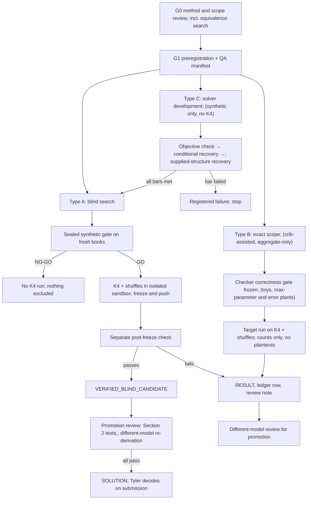
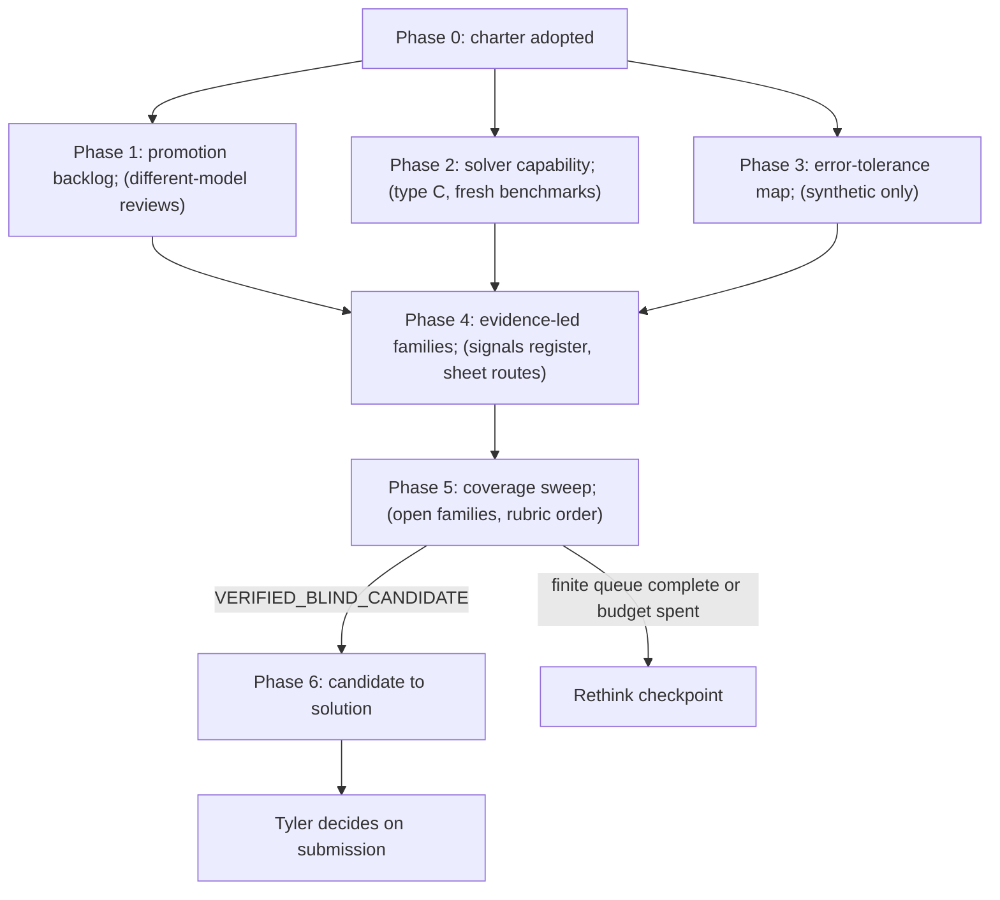

# K4 Research Charter and Roadmap

**Status: ADOPTED** by the merge of PR #106 at `a8f29c0` on 22 November 2026 (America/Chicago).
Drafted by Claude (research chat) from `3a48dec` (PR #105), the R82 council review and the R83 handoff.
Reconciled by ChatGPT on 22 November against the completed R92–R94 work and the separately published R95
branch. Original proposal note: `audit/reviews/RESEARCH_CHARTER_ADOPTION.md`; follow-up review and evidence
limits: `audit/reviews/PR106_CHATGPT_RECONCILIATION.md`.

## 0. What this document is, and what it is not

This is the strategy layer. It says what a legitimate answer is, how the next experiment is chosen, and the
order of work from here to an answer. It does not replace the binding mechanics, which stay where they are:

| Precedence | Document | Governs |
| --- | --- | --- |
| 1 | `r53/BLIND_RULES.md` | Owner rule: the candidate generator never sees published letters; freeze before reveal |
| 2 | `audit/FUTURE_TEST_GUARDRAILS.md` and `audit/check_guardrails.py` | G0–G4, CI rules 1–10, claim vocabulary, independent-review promotion |
| 3 | `k4kit/CLAUDE.md` | Working rules: no external submissions without Tyler, preregister, controls, raw text |
| 4 | This charter | Answer bar, family selection, solver programme, K4 evidence budget, endgame, roadmap |
| 5 | Round files (`rNN/`) and work orders | One experiment each |

If this charter conflicts with documents 1–3, they win; Tyler's explicit instructions take precedence.
Changing a binding rule requires his authorization and an `audit/reviews/` note (CI rule 9).
This charter changes no frozen file, no ledger row and no guardrail.

**Input boundary:** this is a coordination and review document. It contains published plaintext and
clue-derived historical observations and must never be mounted into a blind solver or supplied to a
candidate-construction prompt. Generators receive only their separately reviewed input allowlist.

**Immediate priority:** finish the existing R95 scoring diagnostic's publication and verification chain
(Section 6.2). The user's "25m" means the 25-meter next milestone. R93's different-model review is a
separate parallel task; completing the long-term roadmap or new registers is not a prerequisite for R95.

---

## 1. Where the project stands (22 November 2026)

**No verified K4 solution. Nothing has been submitted to any external verifier.** Rounds R1–R94 are recorded in
`LEDGER.md` (rows L01–L183). R95 is separately preregistered and has one recorded primary invocation,
but its complete evidence and scalar verification are not yet established by the published branch; no
scientific pass/fail is adopted here. `CURRENT_STATUS.md` holds the live state;
`docs/CIPHER_TYPES_TESTED.md` is the plain-words coverage guide.

### 1.1 Coverage in one table

| Area | Status | Main rows |
| --- | --- | --- |
| Pure transposition; one fixed substitution alphabet | EXCL (letter counts; QQ → NO) | L01, L02 |
| Periodic Vigenère / Beaufort / Quagmire in place; sums of 2–4 periodic keys | EXCL for short periods and wherever ≥ 3 checks exist | L03–L05, L36 |
| Two keyword stages on different tableaux (R75 F1, R80a, linked key LX) | Exact-excluded within F1X and LX scopes; R84 blind NO_SIGNAL; 1 LX setting open at chance (m 20) | L165, L172, L173 |
| Gromark / decimal streams; linear recurrences; lagged Fibonacci | EXCL (any cipher alphabet with AZ/KRYPTOS plain) | L14, L15, L49, L157 |
| Autokey | CTAK EXCL to lag 67 (71 along paths); PFX exact; long lags OPEN | L17, L157, L172 |
| Running keys | Named texts EXCL; unknown English, German and clock-city keys STAT no signal | L149–L153, L159 |
| Homophonic substitution | In place EXCL; with listed routes no signal or EXCL | L155 |
| Keyword feedback, walking key, per-slot progressions | EXCL within scopes; WPX with one wrong letter not decided at s = 2 | L169, L170, L172 |
| One stepping rotor, any wiring, 16 contact pairs, position-only stepping, n 1–96, every phase | EXACT_SCOPE_EXCL (R92, and R87's labels through n = 4, independently verified; the rest one model) | L176, L181, L182 |
| Stepped progressive Quagmire, one free alphabet | EXCL exact; blind NO_SIGNAL | L177 |
| F26 / F26L mixed-alphabet classes (35 classes) | INDEPENDENTLY VERIFIED — EXACT_SCOPE_EXCL | L178, L179 |
| Two rotors, RX2-O | Earlier finite development and R94 A/B stopped with SOLVER_NO_POWER; family OPEN; R95 score diagnostic awaiting closeout | L183, `audit/backlog/CLOSEOUT.md`, Section 6.2 |
| Two rotors, RX2-D | Reversible design and synthetic correctness work only; no recovery experiment or K4 run; OPEN | `audit/backlog/multirotor/DESIGN.md` |
| Two free alphabets with an unknown key | Truth identifiable by the word model but not reached by search; OPEN — the main technical gap | L138 |
| Masking layers, strip and cylinder ciphers, changing-alphabet ACA types, other transpositions, other languages | OPEN | L26, L33, `docs/CIPHER_TYPES_TESTED.md` §17 |

### 1.2 The binding constraint is solver power

Ideas are not scarce; working blind solvers are. Each recent attempt to search a wider family failed on its own
planted data before K4 was touched:

- The tested quadgram objectives failed to distinguish truth in their recorded scopes: decoys outscored
  it 2,560/2,560 (L23); wrong texts matched or beat it with two free alphabets (L138). This does not rule out
  every quadgram objective or every 97-letter recovery problem.
- The tested word objective distinguished truth on the L138 panel, but the tested search did not reach it.
- R91: the R82 linked-key solver recovered 250/360 (fails at m ≥ 7); the PTAK solver 32/240 (L180).
- R94: two-rotor search 0/48; a wrong neighbouring text outscored the truth in 39/48 cases, and even with one
  true wiring supplied, recovery was 0/48 (L183).

### 1.3 Observations and their provenance

| Signal | Measure | Current reading | Row |
| --- | --- | --- | --- |
| Flat letter counts | IC 0.0361; all 26 letters present | Descriptive only; fits long-period, running-key, homophonic or masked systems | R54 |
| Lag-7 periodicity | Family-wise p ≈ 0.15 | Not significant | R54 |
| SNAKE_L route gap | p 0.0033 on fresh nulls (R65) | ARTIFACT (R69); residual "row 4 reversed" effect p 0.002, reported only | L154, L158 |
| Width-7 / width-21 fingerprints | Joint shuffle rate 8 × 10⁻⁵; feature selection uncorrected | NO_FAMILY: none of 7 tested families produces it | L160 |
| Sanborn's sheet layout | 14 × 31 sheet = K3 ciphertext + separator + K4 ciphertext; K3 = ×251 mod 337 | Documented; 26 directed sheet routes never run; R73 ON HOLD | L161 |

These ciphertext/layout observations identify no method. Their selection history and validity limit any
use under Section 7; the ARTIFACT and uncorrected entries are not established family evidence.

**Quarantined, published-letter-derived record:** L165's implied-key shape (near repeats 7 vs 1.6;
reported family-wise p 0.035, partly post hoc) uses known plaintext relationships. It is retained for
auditing its historical claim, not as a ciphertext-only signal. It cannot select a blind family, key,
score, dictionary or candidate-construction prompt. The same restriction applies to all crib-derived
features and survivors, regardless of whether their exposure is disclosed.

### 1.4 Outside facts that shape the endgame

- Paradigm's [12 June 2026 announcement](https://www.paradigm.xyz/writing/kryptos), rechecked 22 November,
  describes stewardship of the archive and a SHA-256/HMAC verifier without its staff seeing the plaintext,
  a $1 submission fee, possession of the 97-character K5 ciphertext for future release, and ten CTF puzzles.
  Recheck release status, verifier format and CTF eligibility before acting; the announcement is not a live
  competition-status check.
- In September 2025 two writers found the K4 plaintext in Sanborn's papers at the Smithsonian's Archives of
  American Art. It has not been published by them, but contamination is a live risk (Section 12).
- Sanborn's November 2025 clues: a 1986 trip to Egypt and the 1989 fall of the Berlin Wall figure in the
  solution, and BERLINCLOCK means the World Clock in Berlin. He also asked, "Who says it is even a math solution?"
  Historical context can inform independently justified mechanisms; published-letter clues remain
  validation-only. This paragraph is not an allowable blind-generator input.

---

## 2. The bar for a legitimate answer

A legitimate answer is a method plus a key, recovered blind, that turns the 97 ciphertext letters into readable
plaintext. It must pass all six tests, which restate `r53/BLIND_RULES.md` item 6 and the last G4 bullet:

1. **Recovered blind.** It came out of a preregistered type A round (Section 5) whose generator never saw the
   published letters, and it was frozen and pushed before any known-letter check.
2. **Readable over all 97 letters**, reported raw and unedited. The 73 unpublished positions are the test.
3. **Exact re-encryption** of the unchanged canonical ciphertext, letter for letter, under the binding
   owner rule. Section 8's error models qualify exclusions; they do not waive this solution requirement.
4. **Agrees with all 24 published letters** (EASTNORTHEAST at 22–34 and BERLINCLOCK at 64–74, 1-based) in the
   separate post-freeze check. A disagreement rejects that configuration under the current rules.
5. **Reproducible, independent key derivation.** A key fitted to a guessed text proves nothing. Economy
   and plausibility with 1990 tools are evidence to assess, not an arbitrary short-key requirement; an
   independently sourced longer key is not the same as a fitted position-by-position key.
6. **Independently re-derived** by a different model or a person (G4, CI rule 10) from the written method and
   key, with the family's size and its null false-positive rate reported.

These never count, however readable:

- Plaintext from archives, the Paradigm sale, a leak, or anyone who has seen the solution.
- Text built around the published letters, or a crib-assisted survivor that was decoded (G3 forbids decoding).
- Any output from a method changed after seeing K4 results, unless re-run as a new preregistered round with the
  exposure disclosed (`r53/BLIND_RULES.md` item 5).

Only Tyler decides whether anything is submitted to Paradigm or announced (`k4kit/CLAUDE.md` rule 1).

---

## 3. Lessons that now govern the work

Each lesson was paid for in an earlier round. Together they explain the roadmap in Section 11.

| # | Lesson | Evidence | What it requires now |
| --- | --- | --- | --- |
| 1 | Solver power, not ideas, is the bottleneck | L23, L138, R91 (L180), R94 (L183) | Identifiability check, then conditional recovery, then a fresh gate, before any new joint search (Section 5, type C) |
| 2 | Exact checks give the cheapest strong negatives | R83a, R87–R93 (L172, L176–L182) | Prefer exact-only rounds where an exact check exists; emit counts only (G3) |
| 3 | Parameter labels are not distinct ciphers | R91 cells inside R83 LX; R93 finite-clock duplicates (145,728, not 145,920); 192 phase labels missed by R87 | G0 equivalence search before every round; coverage recorded as functions (Section 9) |
| 4 | Error models must follow the cipher's state | R83a WPX drop-one withdrawn; T1 re-check | G2 corruption tests that recompute downstream state |
| 5 | Counts need arbitrary precision | R75 F1X int64 overflow | Python `int` for counts (G2, reviewer checklist) |
| 6 | Independent review finds defects that replays miss | ChatGPT found the WPX defect (PR #90) | Promotion needs a different model or a person (rule 10) |
| 7 | Controls get spent | R91 controls; R94/R95's spent 48-case panel | Fresh, never-seen controls for every gate; reusable panels and public CTFs are development evidence |
| 8 | Anomalies are cheap to find and costly to confirm | SNAKE_L replicated, then ARTIFACT (L154, L158); L160 NO_FAMILY; L165 partly post hoc | Provenance-labelled register; calibrated predictions; crib-derived observations quarantined (Section 7) |
| 9 | Stopping rules bind | R94: unused ceilings authorize nothing; RX2-O stopped after v3 | At most two versions per work order; stop at the first failed bar |
| 10 | Isolation works | R84, R87, R88, R92 ran in isolated sandboxes with freezes pushed before reveal | Keep the R53 container pattern for every K4 run |
| 11 | Sanborn's documented process is productive | R72 reproduced K3 letter for letter from its worksheets | Rubric question 4 favours mechanisms grounded in documented sheet operations |

---

## 4. Claim vocabulary

New rows use the G4 vocabulary. Legacy words (EXCL, STAT, SCORE, WEAK, FEAS) stay on old rows unchanged.

| Word | May claim | May not claim |
| --- | --- | --- |
| EXACT_SCOPE_EXCL | No setting in the stated scope fits, under its stated error model | Anything about neighbouring settings or other error models |
| POSTFREEZE_CONDITIONAL_EXCL | Excluded by a post-freeze check, given the blind run's assumptions | That the blind search would have found the truth |
| STAT_NO_SIGNAL | K4 scores no better than nulls through this pipeline | Exclusion; the family may be beyond the solver |
| SOLVER_NO_POWER | The solver failed its own planted data | Anything about K4 or the cipher family |
| INCOMPLETE | The job did not finish within budget | A negative result |
| OPEN | Untested, or tested without measured power | — |
| SUPERSEDED | Replaced by a named later row | — |
| VERIFIED_BLIND_CANDIDATE | A blind output that passed the post-freeze check | That it is the solution; Section 2 tests 5 and 6 remain |
| INDEPENDENTLY VERIFIED (qualifier) | A different model or person re-derived the result | — |

For each new exclusion row, the charter asks for three short tags in its text: **method** (exact or blind),
**error tolerance** (Section 8 classes), and **review** (NONE, PARTIAL or YES with the reviewer's name). Existing
rows are not rewritten; Phase 3 publishes the tags for them in a separate table.

---

## 5. Three kinds of round

Every round declares its type in its round card (Section 14) and its QA manifest.



- **Type A, blind search** (R84, R87, R88, R92 blind parts). The only route to a candidate. Gate per stratum on
  fresh concealed books with family and parameters hidden; K4 plus at least 100 shuffles (200 preferred) through
  `audit/run_bounded.py` in the R53 sandbox; freeze pushed before the separate evaluator runs.
- **Type B, exact scope** (R83a, R93, the exact parts of R87–R92). Crib-assisted and exclusion-only.
  Outputs follow the preregistered evidence contract. The active R93 review emits aggregate counts and
  evidence metadata only, with no surviving-label lists or strength rankings. No type B experiment emits
  decoded plaintext or completes missing keys from published clues. No clue-conditioned survivor or
  feature may seed, prune, rank or select a later type A search. Disclosure does not make that information
  flow blind. A later type A family and its full scope need a separate, independently justified derivation.
- **Type C, solver development** (R91, R94, R95). Synthetic only. Stages in order: objective check (truth against
  fixed neighbours), conditional recovery (part of the key supplied), supplied-structure recovery, then a fresh
  full-pipeline gate, which turns it into a type A round. At most two versions per work order under one fixed
  resource cap; stricter registered limits still bind. Stop at the first failed bar, using the registered
  diagnostic outcome (for example R95's SCORE_NO_GO), without inferring that the cipher family is excluded.

---

## 6. Choosing the next family

Tyler's current priority and an already registered work order come first. For unassigned future work, use
the five questions below to compare decision value within a fixed budget. Review work can run in parallel
with solver development; a broad audit backlog does not indefinitely postpone the 25-meter target.
Being untested only breaks a final tie.

1. **Does it change what existing claims mean?** Review backlogs, error tolerance and scorer fixes come first.
2. **Does it explain an eligible ciphertext-only observation** (Section 1.3), and predict a different
   observable with a calibratable joint selection history? Crib-derived features are ineligible.
3. **Does an exact check exist,** or a solver with demonstrated power on fresh controls?
4. **Is it hand-plausible for 1990,** ideally grounded in Sanborn's documented operations (lesson 11)?
5. **How much remaining function space does it close per unit of effort,** after the G0 equivalence search?

Two filters apply before a round card is written:

- **The decision test.** State what happens next if the result is positive and if it is negative. If both
  answers are the same, do not run it.
- **The budget rule.** A family gets one main round and one follow-up. A third needs new evidence, not a new
  idea about the same evidence.

### 6.1 Current queue

| Order | Item | Why here | Next step |
| --- | --- | --- | --- |
| Now — ChatGPT | Finish R95's existing fixed-score evidence chain | The user's 25-meter priority; objective work already registered and run once | Reconcile recovery, publish original evidence, verify and close out (Section 6.2) |
| Now — separate reviewer | Different-model review of L182 (R93) | Active review priority in `audit/reviews/NEXT_STEPS_AFTER_R94.md` | Claude or a person re-derives and replays; ChatGPT cannot independently promote its own result |
| After verified R95 GO | Conditional recovery, then both unknown wirings | A score pass is only the first development prerequisite | Separate complete work order; carry forward Section 6.3's finite bars |
| Later | Two free alphabets with an unknown key | Open technical gap (L138) | Bounded type C proposal with word-level moves |
| Parallel, bounded | Error-tolerance and coverage records | Qualify claims without delaying the active milestone | Record proven scope and OPEN gaps; no new exclusion from documentation alone |
| Later | Eligible signal predictions and R72's 26 sheet routes | Only independently justified, calibrated work | Re-assess R73 hold and apply Sections 6–7 |
| Later | Open families from `docs/CIPHER_TYPES_TESTED.md` §17 | Decision value after equivalence review | Named finite scope, controls and stopping decision |
| Parked | Unchanged R82 broad gate; unchanged long-lag PTAK; finished RX2-O/R94 work orders; covered rotor labels | Decided in `NEXT_STEPS_AFTER_R94.md` | Reopen only with a materially different method and a new registration |

Already completed: R80a (R84, NO_SIGNAL), the linked key's ±1-per-row schedule (R83a LX), R92's finite
independent exact review and the recorded position-stepped single-rotor coverage through period 96
(R87/R92/R93). The combined 148,992 count is of **labels**, not distinct functions or fully independently
certified coverage. R93's 145,728-label independent review is still pending.

### 6.2 Immediate 25-meter target: finish R95

R95 is on [`chatgpt/r95-fixed-score-challenge-20261122`](https://github.com/tylerj-spec/kryptos-k4/tree/chatgpt/r95-fixed-score-challenge-20261122).
The pinned evidence inspected for this review is [`8f59313`](https://github.com/tylerj-spec/kryptos-k4/commit/8f59313c7d4fa6327e0cee41a39f092ebbeb23aa);
its `r95/WORK_ORDER.md`, `PREREGISTRATION.md`, `EXECUTION_HANDOFF.md` and `INTERRUPTION_STATUS.json`
govern this existing round. Registration `c02b7a9` preceded executed source `b347130`.

**Fixed question:** compare one rebuilt order-five language objective with the lower-order baseline on
the spent 48-case R94 panel and all 31,200 legal one-swap neighbors. The primary endpoint counts cases
with **any** below-95/97 neighbor scoring above truth (full summed-score margin > 1e-9); the pass bar is
at most 2/48. The older 25/48
saved-best-neighbor count is only a lower bound, not the baseline endpoint. This is a new fixed objective,
not a replay of the unavailable historical v3 model. Model-file “K5” means language-model order five,
not Kryptos K5 ciphertext.

**Evidence state:** the published branch records one primary invocation but only one recovered neighbor
shard, no complete published freeze and no completed scalar verifier. A later session update reported
55/55 output hashes and 22/22 source/input hashes matching, public practice-input provenance checked,
and publication accepted. That later report still needs reconciliation with the remote artifacts.
Neither process completion nor matching hashes establishes the score's scientific pass/fail.

Finish the existing chain in this order:

1. Reconcile the original outputs, original resource log and full freeze with the later recovery report.
   Check whether any pending publication or verification already completed before invoking anything.
2. Publish the complete preserved primary evidence and freeze before interpretation.
3. Complete the one already registered, separately coded scalar verifier and publish its evidence.
   It must reproduce decryptions, forward witnesses, scores, all neighbor counts and the fixed decision.
4. Record the actual outcome, limitations, review status and closeout in the R95 branch and its PR,
   including the required ledger/review note and repository checks.

Preserve the original allowance: primary 300 wall/240 aggregate CPU seconds/1,024 MiB; verifier
300 wall/240 CPU seconds/512 MiB; one worker and zero retries for each, with a combined ceiling of
600 wall/480 aggregate CPU seconds. The primary's allowance is already spent by its one invocation.
If evidence is missing, retain INCOMPLETE; do not silently rerun it.

| Verified outcome | Next decision |
| --- | --- |
| GO_FOR_CONDITIONAL_DEVELOPMENT | Prepare a separately specified conditional-solver work order; no K4 gate or search is authorized by this score pass |
| SCORE_NO_GO | Close this one objective at its finite scope; any replacement needs a separate justified work order; RX2-O remains OPEN |
| Missing evidence, disagreement or resource failure | Retain INCOMPLETE and identify the missing evidence or defect; no success or exclusion claim |

This is development on spent data. It recovers no unknown key, measures no false-positive rate and makes
no K4 or rotor-family exclusion. The scalar verifier is another ChatGPT code path, not a different-model
review. R93's independent review remains a separate obligation.

### 6.3 Preserve the next-stage decision bars

These are the proposals already recorded in `audit/reviews/NEXT_STEPS_AFTER_R94.md`, not permission to
start another invocation or a replacement for a complete preregistration.

| Stage | Finite scope | Proposed continuation bar |
| --- | --- | --- |
| Objective | R95 now implements one fixed score comparison on 48 × 650 neighbors | Verified primary endpoint at most 2/48, with exact-text misrankings reported separately |
| Conditional recovery | At most two fixed optimizer variants; 48 true-U and 48 true-V conditions | At least 44/48 at >=95/97 in each condition and at least 5/6 in each of eight turnover cells |
| Both wirings unknown, supplied structure | One selected method on the same spent 48 cases | At least 44/48 top-ranked >=95/97 and at least 5/6 per cell; candidate recall reported separately |
| Fresh full-pipeline gate | Newly concealed texts/keys and unknown structural labels; registered confounders and full-search null calibration | Separately reviewed GO before K4; handle nested single-rotor overlap, unused contacts and equivalent keys |

Any new development work order must define seeds, starts, retention, score, source/model provenance and
smaller stage caps within one cumulative budget; the earlier proposed ceiling was 1,800 wall/1,800 CPU
seconds, 2,048 MiB, one worker, at most two versions and zero retries. It does not reset R95's budget
or extend a finished RX2-O/R94 run. Stop at the first failed continuation bar.

Reusable design work includes the reversible RX2-O/RX2-D equations, exact feasibility kernel and clock/key
equivalence analysis. The normalized relation `G_delta = H^delta F`, with H a single 26-cycle, is a possible
future parameterization; no cycle-based solver success has been established. Analyze finite-window clock
equivalence before enumerating periods above 96.

R93's reviewer separately needs a new derivation/feasibility code path, complete registered-label replay,
toy/full-size correctness plants, a frozen throughput gate and aggregate-only outputs. Its suggested
ceiling remains 1,800 wall/1,200 aggregate CPU seconds, 512 MiB and zero retries, to be fixed in its own
review plan before computation. Review only the finite L182 claim; the completed R92 review does not
certify the remaining R87 labels, original optimizer/full-model scores or raw-book freshness.


---

## 7. Statistics and the K4 evidence budget

K4 is one 97-letter sample and cannot be resampled. Every statistic computed on it spends some of its evidence.

- **Same pipeline, same budget.** Power and nulls are measured on the exact solver, scorer and budget used on K4.
- **Strata.** Plants are reported per stratum: ordinary prose, telegraphic X-delimited text (K2 style),
  name-heavy text, masked or nonstandard spelling, and fresh text unseen by the scorer. Failure of any
  required stratum is NO-GO for the registered gate. Removing a failed stratum after revelation does not
  rescue that gate; a narrower future scope needs a new registration and fresh controls.
- **Nulls take the same maximum.** Calibrate on the maximum over every setting and every arm in the round,
  including wrong-family confounders. Report add-one p (R92: 51/201). With n nulls and no false alarm, the 95%
  bound on the false-alarm rate is about 3/n.
- **Labelled settings are not independent trials.** Report labelled and distinct counts (lesson 3).
- **Signals register.** Record each observation's input provenance, selection history, multiplicity and
  p-value where justified (proposed `audit/K4_SIGNALS.md`). Keep crib-derived observations audit-only.
  A new observable on the same repeatedly inspected 97 letters is not independent evidence merely because
  it was preregistered. Calibrate the joint selection procedure and correlated alternatives where possible;
  otherwise retain an exploratory label. A successful prediction supports only its stated mechanism and
  scope, not unique family identification. New ciphertext also needs an applicability/provenance review.
- **Shuffles** keep letter counts and destroy position. They calibrate positional statistics, never global ones.

---

## 8. Error tolerance

Sanborn has said the coded text contains errors, some intentional; K2 needed a carving correction. In the R82
review's linked-key check, one wrong published letter falsely excluded a true plant 3,982 times in 4,000. Every
exclusion therefore states which single errors it survives.

| Class | Error | Covered so far |
| --- | --- | --- |
| E0 | No errors allowed | The default scope of an exclusion with no documented error extension; untested rows remain OPEN |
| E1-crib | One wrong published letter | L35 (periodic, progressive), R81a drop-one (T3), R83a DROP (LX, PFX chance; WPX not decided at s = 2), R87/R88 DROP and two-drop, R90, R92/R93 omission |
| E1-sub | One substituted ciphertext letter, fixed length | R87 (at published positions), R90, R84 diagnostic; R92/R93 position-only rotor proofs cover one substitution anywhere: an observed substitution changes one pair, an unobserved one changes none. R92's finite scope is independently reviewed; R93 is not |
| E1-shift | A published run moved by ±1 or ±2 | R83a SHIFT only |
| E1-indel | One dropped or inserted ciphertext letter | Largely untested |
| E1-state | One lost or doubled state update (worksheet slip) | Required by G2; largely untested |
| E-transcription | A variant reading of the carved ciphertext | Untested |

Tolerance tags qualify the exact method, length, state law, observation positions and reviewed scope.
Single-error classes do not automatically compose: these results do not establish indel tolerance, a lost
state update, shifted observations or simultaneous errors at different positions. Synthetic corruption
checks validate an implementation; extending a K4 exclusion needs an applicable proof or a separately
registered exhaustive target check. Unproved tolerance stays OPEN.

Phase 3 adds scope tags without rewriting old rows. Error-tolerant reconstruction hypotheses must remain
separately labelled; declared errors cannot bypass the exact solution bar in Section 2. Any proposed
change to that binding bar requires a separate explicit owner decision and audit record (D-3).

---

## 9. Integrity additions beyond the CI rules

CI enforces structural checks on frozen files, round directories, QA manifests, recorded gate/freeze order,
resource logs, the clue-word tripwire and promotion form (`audit/FUTURE_TEST_GUARDRAILS.md`); it cannot certify
scientific validity, real isolation or reviewer independence. Three records remain proposed for later
bounded pull requests; creating them does not block the active R95 milestone:

1. **K4 contact index** (`audit/K4_CONTACTS.md`), generated from every round's QA manifest and resource logs:
   date, round, type (A/B/C), what ran, ciphertext-only or crib-using. Mark missing historical records
   explicitly; a manifest-derived index is not proof that all past contact has been captured.
2. **Signals register** (`audit/K4_SIGNALS.md`), Section 7.
3. **Coverage map in function space** (`audit/COVERAGE_MAP.md`): each hand-plausible family, its distinct-function
   scope, status, error tolerance and review status, seeded from `docs/CIPHER_TYPES_TESTED.md` and, once reviewed,
   PR #98's 118-mechanism matrix. Each version is a finite catalogue, not all possible hand-plausible ciphers.

---

## 10. Roles and the relay

Roles follow G4: a builder, an independent breaker and an auditor. Same-model agents, however many, count as one
review.

| Role | Who | Does |
| --- | --- | --- |
| Owner | Tyler | Approves scope, rule changes, exceptions and any submission; relays handoffs |
| Builders | Claude Code and ChatGPT | Run rounds end to end; either may build |
| Independent reviewer | Whichever model did not build the round, or a person | Re-derives for promotion (rule 10) |
| Strategy and research | Claude, research chat | Keeps this charter, writes round cards and reviews, checks sources |

- Handoffs go in `k4kit/handoffs/` or `audit/reviews/` (CI rule 2 rejects new top-level directories). Each opens
  with five plain lines or fewer: what happened, what is asked, what Tyler must decide.
- `CURRENT_STATUS.md` stays the single live status page, updated at every gate.
- Disagreements are numbered; Tyler decides, and his words are quoted in the next preregistration.

---

## 11. Roadmap



1. **Phase 0 — adopted.** PR #106 merged at `a8f29c0`; this reconciliation carries the actual R95 work
   into the active plan. Charter adoption does not amend higher-priority rules.
2. **Phase 1 — promotion backlog, in parallel.** Start with L182 (R93, built by ChatGPT, so Claude or a
   person reviews). Later bounded reviews include remaining L176 (R87), L177 (R88), L172 (R83a) and L165
   (R75 F1X). *Exit per item: a substantiated signed review of its stated scope, or an explicit NONE/PARTIAL
   status and remaining work. Completing the whole backlog is not a prerequisite for Phase 2.*
3. **Phase 2 — solver capability.** First finish R95 under Section 6.2; only verified GO permits a separate
   conditional-development proposal. Share a benchmark **specification**, strata and reporting format,
   while using newly sealed, book-disjoint controls for each decisive gate. Reused panels and public CTF
   puzzles are ancillary development evidence, not fresh holdouts. Later targets are two free alphabets
   with an unknown key (L138), and linked-key/long-lag PTAK only after a materially different method.
   *Exit per work order: its registered scoped outcome within its fixed version/budget limits. Failure
   leaves the family OPEN; development success still needs a separate fresh full-pipeline gate before K4.*
4. **Phase 3 — error-tolerance map, bounded and parallel.** Record proven error scopes and review status;
   mark indels, state slips and other unproved extensions OPEN. Synthetic tests check correctness, not new
   target exclusions. *Exit: each listed major claim has a substantiated tolerance tag or explicit gap;
   extending any claim requires the proof or separately registered work specified in Section 8.*
5. **Phase 4 — eligible observations and documented construction.** Use only eligible ciphertext/layout
   observations, independently justified mechanisms and calibrated predictions under Section 7. Re-assess
   R73's hold on the 26 sheet routes. *Exit: scoped predictive support, a negative, an exploratory outcome
   or INCOMPLETE; no statistic by itself identifies K4's family.*
6. **Phase 5 — finite coverage queue.** Choose a versioned, finite set of open families, equations,
   parameters and error classes. Use type B when a valid exact check exists, or a powered type A method.
   *Exit: a VERIFIED_BLIND_CANDIDATE, or every selected item has a scoped outcome/OPEN disposition, or the
   registered queue budget is reached. This never claims exhaustion of all plausible ciphers.*
7. **Phase 6 — candidate to solution.** Apply Section 2's exact tests, independent re-derivation and
   reproducible key provenance. *Exit: substantiated promotion and Tyler's submission decision.*

**Rethink checkpoint.** Reassess at the finite queue's stopping point, or sooner when repeated measured
power failures undermine its assumptions. Review stage order, masking/null layers, transcription and
language assumptions without selecting candidates from known-letter feedback. Any proposed change to
canonical inputs or validation rules requires its own explicit approval and record. Do not wait for an
undefined claim that all hand-plausible constructions have been excluded.


---

## 12. Triggers and contingencies

| Trigger | Response |
| --- | --- |
| A VERIFIED_BLIND_CANDIDATE appears | Freeze it; pause related rounds; give Tyler a five-line summary; the re-deriving reviewer gets method and key, never the plaintext; no public statement |
| Temptation to probe Paradigm's verifier | Never during search. It would be an answer oracle, and its fee exists to stop brute force. Only promoted candidates are submitted, by Tyler |
| A candidate passes promotion | Apply Tyler's recorded authorization; check the verifier's input format first and log every submission. A "yes" confirms the plaintext, not the method; no submission is part of this review |
| K5 is released | Authenticate its provenance, length and any stated relationship to K4; review checker applicability before use. Give it separate input/contact records and preregistrations. Never transfer K4 published-letter constraints or clue-conditioned survivors into a K5 blind run; register justified joint tests separately (L34 has a diagnostic kit) |
| Paradigm's CTF puzzles | Read current official rules and document answer exposure/training overlap. Use public problems as ancillary development diagnostics; they do not replace fresh concealed controls or R95's active milestone |
| A claimed K4 plaintext appears | No one on the project opens it or the Smithsonian images. Log any exposure; later work is labelled plaintext-informed. If the true text becomes public, the goal becomes reconstructing the method, a separate labelled claim |
| A new Sanborn or Paradigm statement | Record it with date and link in `docs/KRYPTOS_FACTS.md`. It may reorder the queue through rubric question 4, never a running round |
| A critical rule, input boundary or checker proves wrong mid-round | Stop the affected computation; preserve existing evidence and logs; document the defect and restrict the claim. Repair by additive erratum/new registration and fresh required controls before resuming; never overwrite a freeze or finish an invalid run merely to use its budget |

---

## 13. Decisions and standing authority

- [x] **D-1. Charter adoption:** PR #106 merged on 22 November 2026 (America/Chicago).
- [x] **D-2. Immediate target:** the user's 25-meter directive is implemented by R95's existing fixed-score
  work order. Finish its evidence chain before choosing another objective or optimizer. R93's
  different-model review proceeds separately.
- **Git publication:** Tyler explicitly authorized, “You have permission to push anything to git.”
  This covers the planning update without another permission request; it does not change scientific
  gates, retry limits or promotion requirements.
- **D-3. Error-model exceptions:** no waiver of exact re-encryption or published-letter agreement is
  granted by this charter. Error-tolerance research may proceed within its registered scope; any change
  to the solution bar needs a concrete, separate owner decision when relevant.
- **D-4. External verification:** follow Tyler's existing explicit authorization and the binding input/
  freeze requirements. Neither this review nor R95 produces a candidate for submission.
- **D-5. CTF use:** optional development diagnostics after checking current rules and exposure; it is not
  a prerequisite for the immediate milestone or a replacement for a concealed gate.
- **D-6. K5 and contamination:** apply Section 12's provenance, applicability and input-isolation checks.
  Any material change to an active round is separately registered; no speculative release blocks R95.
- [x] **D-7. R95 closed (23 November 2026, additive).**
  - Tyler: "Yes, that is fine with closing 95".
  - The outcome GO_FOR_CONDITIONAL_DEVELOPMENT (order-5 objective 1/48 against the ≤ 2/48 bar; baseline 32/48)
    rests on Claude Code's independent replication. That replication rebuilt the registered model digest and
    reproduced the recovered primary shard exactly.
  - R95's lost primary outputs and its unused same-model verifier are no longer required.
  - Next is the §6.3 conditional-recovery work order, separately specified. No K4 run is authorized.
  - See `audit/reviews/R95_CLOSEOUT.md`.


---

## 14. Round card template

Copy to `rNN/ROUND_CARD.md` before the G0 review. A blank field is an open question for the reviewer.

```markdown
# RNN round card
Type: A blind / B exact scope / C solver development
Builder: | Breaker: | Auditor: | Date:

## Family and scope (G0)
- Hypothesis ID and complete equations (encrypt and inverse), with a worked example:
- Catalogue (all ranges); labelled count; distinct-function count:
- Equivalence search: ledger rows and code checked, and what overlaps:
- Neighbours left out (stay OPEN) and `not_excluded` text for the QA manifest:

## Why this family (charter Section 6)
- Q1 changes existing claims?
- Q2 signal it explains, and the second observable it predicts:
- Q3 exact check, or solver with demonstrated power?
- Q4 hand-plausible for 1990; documented-process grounding:
- Q5 function space closed per effort:
- Decision test: if positive ... / if negative ...
- Budget rule: main round or follow-up?

## Methods and power
- Solver, objective and its provenance; budget; versions allowed (type C: at most two):
- Exact checker and its independent second implementation (type B):
- Strata and fresh plant sources; pass bar per stratum:
- Nulls: families, n per family, false-alarm bound:
- Error classes measured (charter Section 8):

## K4 contact
- Planned K4 computations (for the contact index):
- Shuffles: number and seed
- Sandbox and `audit/run_bounded.py` limits:

## Approvals and outputs
- Approvals needed, with Tyler's words quoted:
- Expected ledger rows and their method / tolerance / review tags:
- Who will do the different-model review:
```

---

## Sources

Repository: `LEDGER.md`; `CURRENT_STATUS.md`; `r53/BLIND_RULES.md`; `audit/FUTURE_TEST_GUARDRAILS.md`;
`k4kit/CLAUDE.md`; `audit/reviews/NEXT_STEPS_AFTER_R94.md`; `audit/backlog/CLOSEOUT.md`;
`docs/CIPHER_TYPES_TESTED.md`; open PR #98 (mechanism matrix, unmerged draft);
`audit/reviews/PR106_CHATGPT_RECONCILIATION.md` and its pinned R95 branch references.

External (opened 22 November 2026):
- [Paradigm, "Project Kryptos" (12 June 2026)](https://www.paradigm.xyz/writing/kryptos): stewardship, verifier design and
  fee, K5, CTF.
- [Paradigm, About Kryptos](https://www.paradigm.xyz/kryptos/about): stewards since November 2025.
- [Scientific American, solution found in the archives](https://www.scientificamerican.com/article/a-solution-to-the-cias-kryptos-code-is-found-after-35-years/).
- [Scientific American, Sanborn's final clues](https://www.scientificamerican.com/article/cia-kryptos-puzzle-creator-releases-final-clues/).
