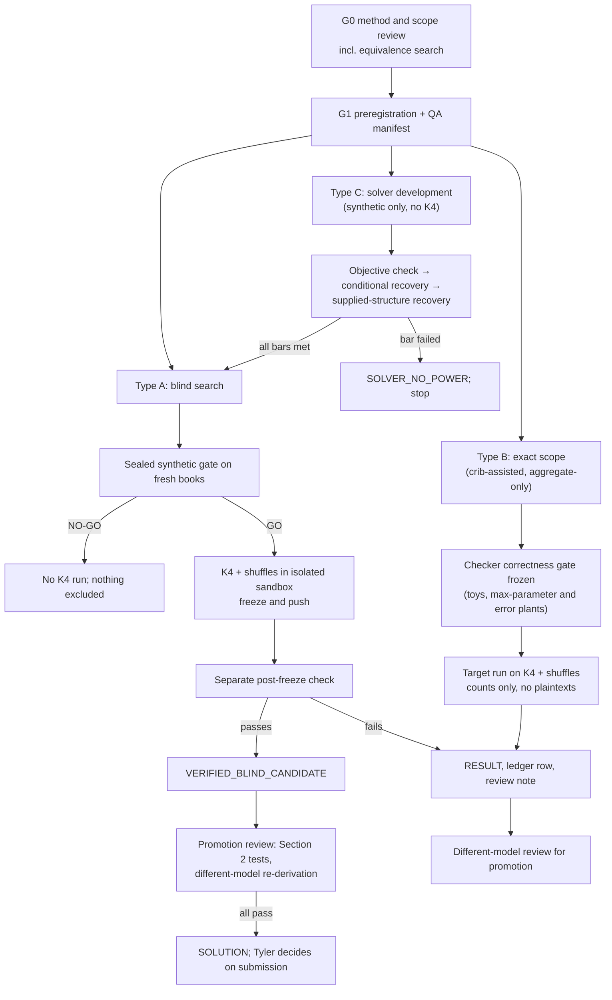
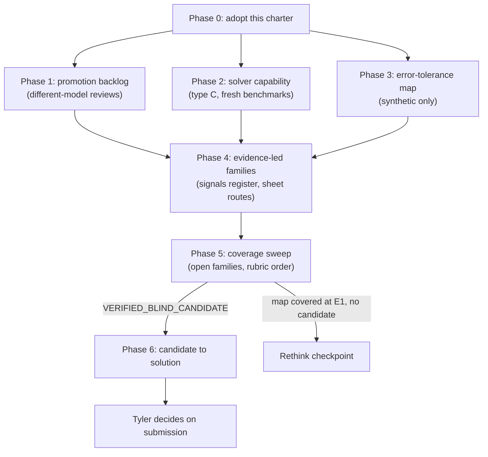

# K4 Research Charter and Roadmap

**Status: PROPOSED.** It takes effect when Tyler merges the pull request that adds it.
Drafted 22 November 2026 (America/Chicago) by Claude (research chat) from the repository at `3a48dec`
(after PR #105), the R82 council review and the R83 handoff. Companion review note:
`audit/reviews/RESEARCH_CHARTER_ADOPTION.md`.

## 0. What this document is, and what it is not

This is the strategy layer. It says what a legitimate answer is, how the next experiment is chosen, and the
order of work from here to an answer. It does not replace the binding mechanics, which stay where they are:

| Precedence | Document | Governs |
| --- | --- | --- |
| 1 | `r53/BLIND_RULES.md` | Owner rule: the candidate generator never sees published letters; freeze before reveal |
| 2 | `audit/FUTURE_TEST_GUARDRAILS.md` and `audit/check_guardrails.py` | G0–G4, CI rules 1–10, claim vocabulary, independent-review promotion |
| 3 | `k4kit/CLAUDE.md` | Working rules: no external submissions without Tyler, preregister, controls, raw text |
| 4 | This charter | Answer bar, family selection, solver programme, K4 evidence budget, endgame, roadmap |
| 5 | Round files (`rNN/`) and work orders | One experiment each |

If this charter conflicts with documents 1–3, they win. Changing any of them needs Tyler's written approval and
an `audit/reviews/` note (CI rule 9). This charter changes no frozen file, no ledger row and no guardrail.

---

## 1. Where the project stands (22 November 2026)

**No verified K4 solution. Nothing has been submitted to any external verifier.** Rounds R1–R94 are recorded in
`LEDGER.md` (rows L01–L183). `CURRENT_STATUS.md` holds the live state; `docs/CIPHER_TYPES_TESTED.md` is the plain-words
coverage guide.

### 1.1 Coverage in one table

| Area | Status | Main rows |
| --- | --- | --- |
| Pure transposition; one fixed substitution alphabet | EXCL (letter counts; QQ → NO) | L01, L02 |
| Periodic Vigenère / Beaufort / Quagmire in place; sums of 2–4 periodic keys | EXCL for short periods and wherever ≥ 3 checks exist | L03–L05, L36 |
| Two keyword stages on different tableaux (R75 F1, R80a, linked key LX) | Exact-excluded within F1X and LX scopes; R84 blind NO_SIGNAL; 1 LX setting open at chance (m 20) | L165, L172, L173 |
| Gromark / decimal streams; linear recurrences; lagged Fibonacci | EXCL (any cipher alphabet with AZ/KRYPTOS plain) | L14, L15, L49, L157 |
| Autokey | CTAK EXCL to lag 67 (71 along paths); PFX exact; long lags OPEN | L17, L157, L172 |
| Running keys | Named texts EXCL; unknown English, German and clock-city keys STAT no signal | L149–L153, L159 |
| Homophonic substitution | In place EXCL; with listed routes no signal or EXCL | L155 |
| Keyword feedback, walking key, per-slot progressions | EXCL within scopes; WPX with one wrong letter not decided at s = 2 | L169, L170, L172 |
| One stepping rotor, any wiring, 16 contact pairs, position-only stepping, n 1–96, every phase | EXACT_SCOPE_EXCL (R92, and R87's labels through n = 4, independently verified; the rest one model) | L176, L181, L182 |
| Stepped progressive Quagmire, one free alphabet | EXCL exact; blind NO_SIGNAL | L177 |
| F26 / F26L mixed-alphabet classes (35 classes) | INDEPENDENTLY VERIFIED — EXACT_SCOPE_EXCL | L178, L179 |
| Two rotors (RX2-O, RX2-D) | Designed; SOLVER_NO_POWER; OPEN | L183, `audit/backlog/CLOSEOUT.md` |
| Two free alphabets with an unknown key | Truth identifiable by the word model but not reached by search; OPEN — the main technical gap | L138 |
| Masking layers, strip and cylinder ciphers, changing-alphabet ACA types, other transpositions, other languages | OPEN | L26, L33, `docs/CIPHER_TYPES_TESTED.md` §17 |

### 1.2 The binding constraint is solver power

Ideas are not scarce; working blind solvers are. Each recent attempt to search a wider family failed on its own
planted data before K4 was touched:

- Quadgram scoring cannot identify 97-letter text: decoys outscored the truth 2,560/2,560 (L23); wrong texts
  matched or beat it with two free alphabets (L138).
- The word model identifies the truth with two free alphabets, but search does not reach it (L138).
- R91: the R82 linked-key solver recovered 250/360 (fails at m ≥ 7); the PTAK solver 32/240 (L180).
- R94: two-rotor search 0/48; a wrong neighbouring text outscored the truth in 39/48 cases, and even with one
  true wiring supplied, recovery was 0/48 (L183).

### 1.3 K4 signals register (ciphertext-only observations)

| Signal | Measure | Current reading | Row |
| --- | --- | --- | --- |
| Flat letter counts | IC 0.0361; all 26 letters present | Descriptive only; fits long-period, running-key, homophonic or masked systems | R54 |
| Lag-7 periodicity | Family-wise p ≈ 0.15 | Not significant | R54 |
| SNAKE_L route gap | p 0.0033 on fresh nulls (R65) | ARTIFACT (R69); residual "row 4 reversed" effect p 0.002, reported only | L154, L158 |
| Width-7 / width-21 fingerprints | Joint shuffle rate 8 × 10⁻⁵; feature selection uncorrected | NO_FAMILY: none of 7 tested families produces it | L160 |
| Implied-key shape | A–Z sum form; near repeats 7 vs 1.6; family-wise p 0.035, partly post hoc | Class DIGITS conflicts with L14: chance or another mechanism | L165 |
| Sanborn's sheet layout | 14 × 31 sheet = K3 ciphertext + separator + K4 ciphertext; K3 = ×251 mod 337 | Documented; 26 directed sheet routes never run; R73 ON HOLD | L161 |

None of these identifies a method. Section 7 sets how they may be used.

### 1.4 Outside facts that shape the endgame

- Paradigm has held the K4 secret since November 2025. Since June 2026 it runs a public verifier that checks a
  submitted plaintext against a hash of Sanborn's answer, with a $1 fee per try to prevent brute force. It also
  holds the 97-character K5 ciphertext and plans to release it, and runs a 10-puzzle Kryptos-style CTF.
- In September 2025 two writers found the K4 plaintext in Sanborn's papers at the Smithsonian's Archives of
  American Art. It has not been published by them, but contamination is a live risk (Section 12).
- Sanborn's November 2025 clues: a 1986 trip to Egypt and the 1989 fall of the Berlin Wall figure in the
  solution, and BERLINCLOCK means the World Clock in Berlin. He also asked, "Who says it is even a math solution?"
  These are soft priors only.

---

## 2. The bar for a legitimate answer

A legitimate answer is a method plus a key, recovered blind, that turns the 97 ciphertext letters into readable
plaintext. It must pass all six tests, which restate `r53/BLIND_RULES.md` item 6 and the last G4 bullet:

1. **Recovered blind.** It came out of a preregistered type A round (Section 5) whose generator never saw the
   published letters, and it was frozen and pushed before any known-letter check.
2. **Readable over all 97 letters**, reported raw and unedited. The 73 unpublished positions are the test.
3. **Exact re-encryption** of the canonical ciphertext, letter for letter, except declared error positions
   (Section 8), each with its class.
4. **Agrees with the 24 published letters** (EASTNORTHEAST at 22–34 and BERLINCLOCK at 64–74, 1-based) in the
   separate post-freeze check, or explains each disagreement as a declared error.
5. **A key that makes sense:** a few lines, runnable by hand with 1990 tools, not a fitted 97-position key.
6. **Independently re-derived** by a different model or a person (G4, CI rule 10) from the written method and
   key, with the family's size and its null false-positive rate reported.

These never count, however readable:

- Plaintext from archives, the Paradigm sale, a leak, or anyone who has seen the solution.
- Text built around the published letters, or a crib-assisted survivor that was decoded (G3 forbids decoding).
- Any output from a method changed after seeing K4 results, unless re-run as a new preregistered round with the
  exposure disclosed (`r53/BLIND_RULES.md` item 5).

Only Tyler decides whether anything is submitted to Paradigm or announced (`k4kit/CLAUDE.md` rule 1).

---

## 3. Lessons that now govern the work

Each lesson was paid for in an earlier round. Together they explain the roadmap in Section 11.

| # | Lesson | Evidence | What it requires now |
| --- | --- | --- | --- |
| 1 | Solver power, not ideas, is the bottleneck | L23, L138, R91 (L180), R94 (L183) | Identifiability check, then conditional recovery, then a fresh gate, before any new joint search (Section 5, type C) |
| 2 | Exact checks give the cheapest strong negatives | R83a, R87–R93 (L172, L176–L182) | Prefer exact-only rounds where an exact check exists; emit counts only (G3) |
| 3 | Parameter labels are not distinct ciphers | R91 cells inside R83 LX; R93 finite-clock duplicates (145,728, not 145,920); 192 phase labels missed by R87 | G0 equivalence search before every round; coverage recorded as functions (Section 9) |
| 4 | Error models must follow the cipher's state | R83a WPX drop-one withdrawn; T1 re-check | G2 corruption tests that recompute downstream state |
| 5 | Counts need arbitrary precision | R75 F1X int64 overflow | Python `int` for counts (G2, reviewer checklist) |
| 6 | Independent review finds defects that replays miss | ChatGPT found the WPX defect (PR #90) | Promotion needs a different model or a person (rule 10) |
| 7 | Controls get spent | R91 controls; R94's spent 48-case panel | Fresh, never-seen controls for every gate; spent panels are development only |
| 8 | Anomalies are cheap to find and costly to confirm | SNAKE_L replicated, then ARTIFACT (L154, L158); L160 NO_FAMILY; L165 partly post hoc | Signals register and second-observable rule (Section 7) |
| 9 | Stopping rules bind | R94: unused ceilings authorize nothing; RX2-O stopped after v3 | At most two versions per work order; stop at the first failed bar |
| 10 | Isolation works | R84, R87, R88, R92 ran in isolated sandboxes with freezes pushed before reveal | Keep the R53 container pattern for every K4 run |
| 11 | Sanborn's documented process is productive | R72 reproduced K3 letter for letter from its worksheets | Rubric question 4 favours mechanisms grounded in documented sheet operations |

---

## 4. Claim vocabulary

New rows use the G4 vocabulary. Legacy words (EXCL, STAT, SCORE, WEAK, FEAS) stay on old rows unchanged.

| Word | May claim | May not claim |
| --- | --- | --- |
| EXACT_SCOPE_EXCL | No setting in the stated scope fits, under its stated error model | Anything about neighbouring settings or other error models |
| POSTFREEZE_CONDITIONAL_EXCL | Excluded by a post-freeze check, given the blind run's assumptions | That the blind search would have found the truth |
| STAT_NO_SIGNAL | K4 scores no better than nulls through this pipeline | Exclusion; the family may be beyond the solver |
| SOLVER_NO_POWER | The solver failed its own planted data | Anything about K4 or the cipher family |
| INCOMPLETE | The job did not finish within budget | A negative result |
| OPEN | Untested, or tested without measured power | — |
| SUPERSEDED | Replaced by a named later row | — |
| VERIFIED_BLIND_CANDIDATE | A blind output that passed the post-freeze check | That it is the solution; Section 2 tests 5 and 6 remain |
| INDEPENDENTLY VERIFIED (qualifier) | A different model or person re-derived the result | — |

For each new exclusion row, the charter asks for three short tags in its text: **method** (exact or blind),
**error tolerance** (Section 8 classes), and **review** (NONE, PARTIAL or YES with the reviewer's name). Existing
rows are not rewritten; Phase 3 publishes the tags for them in a separate table.

---

## 5. Three kinds of round

Every round declares its type in its round card (Section 14) and its QA manifest.



- **Type A, blind search** (R84, R87, R88, R92 blind parts). The only route to a candidate. Gate per stratum on
  fresh concealed books with family and parameters hidden; K4 plus at least 100 shuffles (200 preferred) through
  `audit/run_bounded.py` in the R53 sandbox; freeze pushed before the separate evaluator runs.
- **Type B, exact scope** (R83a, R93, the exact parts of R87–R92). Crib-assisted and exclusion-only. Outputs are
  compatibility counts and setting labels, never plaintexts or completed keys (G3). A surviving setting is
  recorded, not pursued; it can enter a later type A round only with its exposure disclosed.
- **Type C, solver development** (R91, R94). Synthetic only. Stages in order: objective check (truth against
  fixed neighbours), conditional recovery (part of the key supplied), supplied-structure recovery, then a fresh
  full-pipeline gate, which turns it into a type A round. At most two versions per work order under one fixed
  resource cap; stop at the first failed bar.

---

## 6. Choosing the next family

Five questions, asked in order; the first that separates two candidates decides. Being untested only breaks a
final tie.

1. **Does it change what existing claims mean?** Review backlogs, error tolerance and scorer fixes come first.
2. **Does it explain a measured K4 signal** (Section 1.3), and does it predict a second, different observable?
3. **Does an exact check exist,** or a solver with demonstrated power on fresh controls?
4. **Is it hand-plausible for 1990,** ideally grounded in Sanborn's documented operations (lesson 11)?
5. **How much remaining function space does it close per unit of effort,** after the G0 equivalence search?

Two filters apply before a round card is written:

- **The decision test.** State what happens next if the result is positive and if it is negative. If both
  answers are the same, do not run it.
- **The budget rule.** A family gets one main round and one follow-up. A third needs new evidence, not a new
  idea about the same evidence.

### 6.1 The queue that results today

| Order | Item | Why here | Next step |
| --- | --- | --- | --- |
| 1 | Different-model review of L182 (R93) | Q1; active priority 1 in `audit/reviews/NEXT_STEPS_AFTER_R94.md` | ChatGPT built R93, so Claude or a person reviews it |
| 2 | Better objective and conditional solver for two rotors | Q1/Q3; active priority 2; bars already written | Type C work order per `NEXT_STEPS_AFTER_R94.md` |
| 3 | Two free alphabets with an unknown key | Q3; main technical gap (L138) | Type C with word-level moves |
| 4 | Error-tolerance map | Q1; qualifies every exclusion | Phase 3 |
| 5 | Signals-register prediction tests | Q2 | Phase 4 |
| 6 | R72 sheet routes (26 directed, never run) | Q4; documented process | Re-assess R73 hold under Section 6 |
| 7 | Open families from `docs/CIPHER_TYPES_TESTED.md` §17 | Q4/Q5 | Phase 5, in rubric order |
| Parked | Unchanged R82 broad gate; unchanged long-lag PTAK; re-enumerating covered rotor labels | Decided in `NEXT_STEPS_AFTER_R94.md` | Reopen only with a materially different method |

Already done since the R82 review and removed from the queue: R80a (R84, NO_SIGNAL), the linked key's ±1-per-row
schedule (R83a LX), and the single position-stepped rotor through period 96 (R87, R92, R93).

---

## 7. Statistics and the K4 evidence budget

K4 is one 97-letter sample and cannot be resampled. Every statistic computed on it spends some of its evidence.

- **Same pipeline, same budget.** Power and nulls are measured on the exact solver, scorer and budget used on K4.
- **Strata.** Plants are reported per stratum: ordinary prose, telegraphic X-delimited text (K2 style),
  name-heavy text, masked or nonstandard spelling, and fresh text unseen by the scorer. A failed stratum is WEAK.
- **Nulls take the same maximum.** Calibrate on the maximum over every setting and every arm in the round,
  including wrong-family confounders. Report add-one p (R92: 51/201). With n nulls and no false alarm, the 95%
  bound on the false-alarm rate is about 3/n.
- **Labelled settings are not independent trials.** Report labelled and distinct counts (lesson 3).
- **Signals register.** Every ciphertext-only statistic computed on K4 is added to Section 1.3's register (to be
  kept as `audit/K4_SIGNALS.md`), with its p-value, its selection history and the number of K4 statistics taken
  before it. A post hoc signal is confirmed only by a preregistered test of a different observable it predicts,
  or by new ciphertext (K5).
- **Shuffles** keep letter counts and destroy position. They calibrate positional statistics, never global ones.

---

## 8. Error tolerance

Sanborn has said the coded text contains errors, some intentional; K2 needed a carving correction. In the R82
review's linked-key check, one wrong published letter falsely excluded a true plant 3,982 times in 4,000. Every
exclusion therefore states which single errors it survives.

| Class | Error | Covered so far |
| --- | --- | --- |
| E0 | None | Default for every untested row |
| E1-crib | One wrong published letter | L35 (periodic, progressive), R81a drop-one (T3), R83a DROP (LX, PFX chance; WPX not decided at s = 2), R87/R88 DROP and two-drop, R90, R92/R93 omission |
| E1-sub | One substituted ciphertext letter | R87 (at published positions), R90 (ciphertext substitution), R84 diagnostic |
| E1-shift | A published run moved by ±1 or ±2 | R83a SHIFT only |
| E1-indel | One dropped or inserted ciphertext letter | Largely untested |
| E1-state | One lost or doubled state update (worksheet slip) | Required by G2; largely untested |
| E-transcription | A variant reading of the carved ciphertext | Untested |

Rules: tolerance tags go on new rows (Section 4); Phase 3 publishes the table for existing rows without
editing them; a SOLUTION may declare at most the number of error positions Tyler sets (Decision D-3).

---

## 9. Integrity additions beyond the CI rules

CI already enforces frozen files, round directories, QA manifests, gate-before-K4 order, freeze verification,
resource logs, the clue-word tripwire and promotion form (`audit/FUTURE_TEST_GUARDRAILS.md`). This charter adds
three records, each proposed for its own later pull request:

1. **K4 contact index** (`audit/K4_CONTACTS.md`), generated from every round's QA manifest and resource logs:
   date, round, type (A/B/C), what ran, ciphertext-only or crib-using. It makes the evidence budget countable.
2. **Signals register** (`audit/K4_SIGNALS.md`), Section 7.
3. **Coverage map in function space** (`audit/COVERAGE_MAP.md`): each hand-plausible family, its distinct-function
   scope, status, error tolerance and review status, seeded from `docs/CIPHER_TYPES_TESTED.md` and, once reviewed,
   PR #98's 118-mechanism matrix.

---

## 10. Roles and the relay

Roles follow G4: a builder, an independent breaker and an auditor. Same-model agents, however many, count as one
review.

| Role | Who | Does |
| --- | --- | --- |
| Owner | Tyler | Approves scope, rule changes, exceptions and any submission; relays handoffs |
| Builders | Claude Code and ChatGPT | Run rounds end to end; either may build |
| Independent reviewer | Whichever model did not build the round, or a person | Re-derives for promotion (rule 10) |
| Strategy and research | Claude, research chat | Keeps this charter, writes round cards and reviews, checks sources |

- Handoffs go in `k4kit/handoffs/` or `audit/reviews/` (CI rule 2 rejects new top-level directories). Each opens
  with five plain lines or fewer: what happened, what is asked, what Tyler must decide.
- `CURRENT_STATUS.md` stays the single live status page, updated at every gate.
- Disagreements are numbered; Tyler decides, and his words are quoted in the next preregistration.

---

## 11. Roadmap



1. **Phase 0 — adopt (now).** Merge this charter. *Exit: Tyler's merge.*
2. **Phase 1 — promotion backlog.** Different-model reviews for the major one-model exclusions, in this order:
   L182 (R93, built by ChatGPT, so Claude or a person reviews), L176 (R87), L177 (R88), L172 (R83a), L165 (R75
   F1X). *Exit: each has a signed YES review, or a recorded reason it stays NONE.*
3. **Phase 2 — solver capability.** One shared benchmark of fresh, never-used controls, plus Paradigm's CTF
   puzzles as an outside check outside the K4 budget. Targets: (a) two-rotor objective and conditional solver,
   per the bars in `NEXT_STEPS_AFTER_R94.md`; (b) two free alphabets with an unknown key (L138), with word-level
   moves; (c) linked key at m ≥ 7 and long-lag PTAK, only with a materially different method. *Exit: a solver
   passes a fresh full-pipeline gate (it becomes a type A round), or each target closes SOLVER_NO_POWER after at
   most two versions.*
4. **Phase 3 — error-tolerance map (synthetic only, parallel).** Consolidate Section 8's coverage into one table
   and fill E1-indel and E1-state for the major exclusions. *Exit: every major EXCL row has a tolerance tag.*
5. **Phase 4 — evidence-led families.** For each signal in Section 1.3, list the hand-plausible mechanisms that
   would produce it and a second observable each predicts; preregister and test those predictions on K4. Re-assess
   the 26 never-run sheet routes (R73 hold). *Exit: a family confirmed by its second observable, or the register
   marked unconfirmed.*
6. **Phase 5 — coverage sweep.** Open families in rubric order: exact type B rounds where an exact check exists
   (for example the linked-key schedules beyond LX's ±1 per row), type A rounds through Phase 2's solvers otherwise.
   *Exit: a VERIFIED_BLIND_CANDIDATE, or the coverage map closed at E1.*
7. **Phase 6 — candidate to solution.** Section 2's tests, a different-model re-derivation from method and key
   only, declared error positions and the chance bound. *Exit: Tyler's decision.*

**Rethink checkpoint.** If Phase 5 closes the hand-plausible map at E1 without a candidate, the next step is a
methodology review, not wider catalogues. It questions shared assumptions: stage order, a masking or null layer,
the canonical transcription, the crib positions, the plaintext language and Sanborn's "not a math solution" remark.

---

## 12. Triggers and contingencies

| Trigger | Response |
| --- | --- |
| A VERIFIED_BLIND_CANDIDATE appears | Freeze it; pause related rounds; give Tyler a five-line summary; the re-deriving reviewer gets method and key, never the plaintext; no public statement |
| Temptation to probe Paradigm's verifier | Never during search. It would be an answer oracle, and its fee exists to stop brute force. Only promoted candidates are submitted, by Tyler |
| A candidate passes promotion | Tyler alone decides on submission; check the verifier's input format first; log every submission. A "yes" confirms the plaintext, not the method |
| K5 is released | Highest-value event: a second 97-letter text under a reportedly similar system. Pause new K4 families; give K5 its own contact index and preregistrations; run each exact checker on it; preregister joint K4/K5 tests separately (L34 has a diagnostic kit) |
| Paradigm's CTF puzzles | Use as an external power benchmark for Phase 2, outside the K4 budget; read the official rules first |
| A claimed K4 plaintext appears | No one on the project opens it or the Smithsonian images. Log any exposure; later work is labelled plaintext-informed. If the true text becomes public, the goal becomes reconstructing the method, a separate labelled claim |
| A new Sanborn or Paradigm statement | Record it with date and link in `docs/KRYPTOS_FACTS.md`. It may reorder the queue through rubric question 4, never a running round |
| A rule proves wrong mid-round | Finish as registered, report the deviation, fix it in the next round |

---

## 13. Decisions for Tyler

- [ ] **D-1. Adopt this charter** by merging its pull request. Recommended: yes. It changes no existing rule,
  frozen file or ledger row.
- [ ] **D-2. First Phase 2 target.** Two-rotor objective/conditional work (its bars are already written) or two
  free alphabets (the larger gap). Recommended: two-rotor first, because it is specified and bounded.
- [ ] **D-3. Error cap for a SOLUTION.** Recommended: at most two declared positions, each a single-letter event
  of a stated class.
- [ ] **D-4. Verifier policy.** Recommended: only after promotion review, by Tyler, with at most a few format
  variants per candidate, all logged.
- [ ] **D-5. CTF use.** Recommended: benchmark first; enter only under the CTF's own rules.
- [ ] **D-6. K5 and contamination.** Recommended: approve the Section 12 responses.

---

## 14. Round card template

Copy to `rNN/ROUND_CARD.md` before the G0 review. A blank field is an open question for the reviewer.

```markdown
# RNN round card
Type: A blind / B exact scope / C solver development
Builder: | Breaker: | Auditor: | Date:

## Family and scope (G0)
- Hypothesis ID and complete equations (encrypt and inverse), with a worked example:
- Catalogue (all ranges); labelled count; distinct-function count:
- Equivalence search: ledger rows and code checked, and what overlaps:
- Neighbours left out (stay OPEN) and `not_excluded` text for the QA manifest:

## Why this family (charter Section 6)
- Q1 changes existing claims?
- Q2 signal it explains, and the second observable it predicts:
- Q3 exact check, or solver with demonstrated power?
- Q4 hand-plausible for 1990; documented-process grounding:
- Q5 function space closed per effort:
- Decision test: if positive ... / if negative ...
- Budget rule: main round or follow-up?

## Methods and power
- Solver, objective and its provenance; budget; versions allowed (type C: at most two):
- Exact checker and its independent second implementation (type B):
- Strata and fresh plant sources; pass bar per stratum:
- Nulls: families, n per family, false-alarm bound:
- Error classes measured (charter Section 8):

## K4 contact
- Planned K4 computations (for the contact index):
- Shuffles: number and seed
- Sandbox and `audit/run_bounded.py` limits:

## Approvals and outputs
- Approvals needed, with Tyler's words quoted:
- Expected ledger rows and their method / tolerance / review tags:
- Who will do the different-model review:
```

---

## Sources

Repository: `LEDGER.md`; `CURRENT_STATUS.md`; `r53/BLIND_RULES.md`; `audit/FUTURE_TEST_GUARDRAILS.md`;
`k4kit/CLAUDE.md`; `audit/reviews/NEXT_STEPS_AFTER_R94.md`; `audit/backlog/CLOSEOUT.md`;
`docs/CIPHER_TYPES_TESTED.md`; open PR #98 (mechanism matrix, unmerged draft).

External (opened 22 November 2026):
- [Paradigm, "Kryptos" (June 2026)](https://www.paradigm.xyz/2026/06/kryptos): stewardship, verifier design and
  fee, K5, CTF.
- [Paradigm, About Kryptos](https://www.paradigm.xyz/kryptos/about): stewards since November 2025.
- [Scientific American, solution found in the archives](https://www.scientificamerican.com/article/a-solution-to-the-cias-kryptos-code-is-found-after-35-years/).
- [Scientific American, Sanborn's final clues](https://www.scientificamerican.com/article/cia-kryptos-puzzle-creator-releases-final-clues/).
